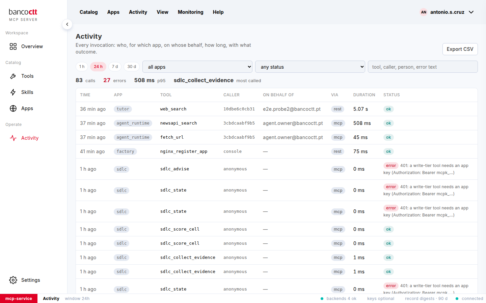

# Read the activity

**Activity** is the record of every invocation, on both faces: REST and MCP.

## Steps

1. Click **Activity** in the side menu.
2. The summary strip: calls, errors, the p95 duration, the most called tool, for the chosen window.
3. The table, newest first: time, app, tool, caller, on behalf of, via (*rest* or *mcp*), duration, status. An
   error shows its message.
4. **Load more** at the bottom brings the next page.

## Notes

- The Overview's **Recent activity** is the last eight calls of the last 30 days.
- A tool's own **Activity** tab shows its last 50 calls.

## See also
- [Filter and export the activity](05-02-filter-and-export.md)
- [Understand a call's record](05-03-understand-a-call.md)
