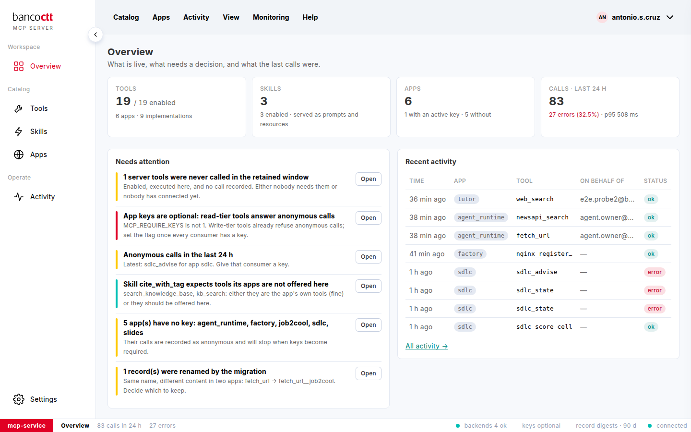

# What needs attention

The Overview's **Needs attention** list is computed from the catalog, the keys and the record. Each item says what,
why, and where to go.

| Item | Why it appears | What to do |
|---|---|---|
| server tools never called | enabled, executed here, no call recorded | connect a consumer, or disable them |
| app keys are optional | read-tier tools answer anonymous calls | give every consumer a key, then require keys |
| anonymous calls in the last 24 h | a caller without a key | find it in Activity and give it a key |
| a tool binds to a missing implementation | the registry names an implementation this version does not ship | edit the tool, or deploy the implementation |
| a skill expects tools its apps are not offered | the skill names tools; they may be the app's own | offer the tool here, or leave it |
| apps without a key | their calls are anonymous and will stop when keys are required | issue keys |
| records renamed by the migration | two apps had the same name with different content | decide which to keep |

## See also
- [Require keys from every caller](07-02-require-keys.md)
- [Monitor the backends](06-02-monitor-the-backends.md)
