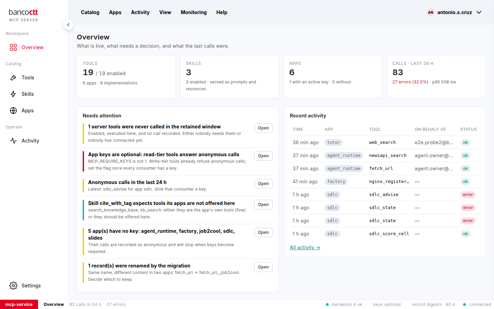

# O que é o MCP Server e como está organizado o ecrã

O MCP Server aloja as **ferramentas** e as **competências** que as aplicações e os agentes do domínio partilham. Uma
ferramenta é uma função que o serviço executa para quem a chama (uma pesquisa na web, a leitura de um URL, um sensor da
avaliação SDLC); uma competência é uma instrução que vários chamadores têm de seguir da mesma forma (uma convenção de
citação, uma regra de língua). Cada uma é **oferecida a aplicações**: uma aplicação ou um agente liga-se como uma
aplicação, com a sua **chave**, e vê o que essa aplicação recebe.

A **Consola MCP** é onde administra tudo isto. Nada aqui executa um modelo: a consola mostra o que é oferecido,
permite alterá-lo e guarda o registo de todas as chamadas.

## O ecrã

- **Menu superior** — *Catálogo, Aplicações, Atividade, Ver, Monitorização, Ajuda*. À direita, o seu nome e
  fotografia: o seu menu muda o tema, a língua, e termina a sessão.
- **Menu lateral** (à esquerda) — as vistas: *Visão geral*, em **Área de trabalho**; *Ferramentas*, *Competências*,
  *Aplicações*, em **Catálogo**; *Atividade*, em **Operação**. *Definições* está em baixo: o seu menu tem o tema, a
  língua e a vista Definições. O botão redondo na margem do menu recolhe-o a ícones; num tablet começa recolhido, e num
  telemóvel é a barra inferior.
- **Área central** — a vista que escolheu. Uma ferramenta ou uma competência abre num **painel** à direita com os seus
  separadores: *Visão geral, Esquema, Experimentar, Ligar, Atividade, Histórico, Editar*.
- **Barra de estado** (em baixo) — da esquerda: o serviço, a vista em que está e os seus detalhes; à direita: os
  serviços de apoio, o modo das chaves, o registo e a ligação.

## Passos para se orientar

1. Olhe para a **Visão geral**: quatro mosaicos (ferramentas, competências, aplicações, chamadas nas últimas 24 horas),
   a lista do que **precisa de atenção** e as últimas chamadas.
2. Clique em **Ferramentas** no menu lateral e selecione uma linha: o painel abre com tudo sobre essa ferramenta.
3. Abra **Ajuda** › **Manual do utilizador** a qualquer momento para voltar aqui. O índice está na coluna à esquerda:
   clique numa página para a abrir.

## Ver também
- [Ler a barra de estado](01-03-the-status-bar.md)
- [Os menus](01-04-the-menus.md)
- [Encontrar uma ferramenta](02-01-find-a-tool.md)
