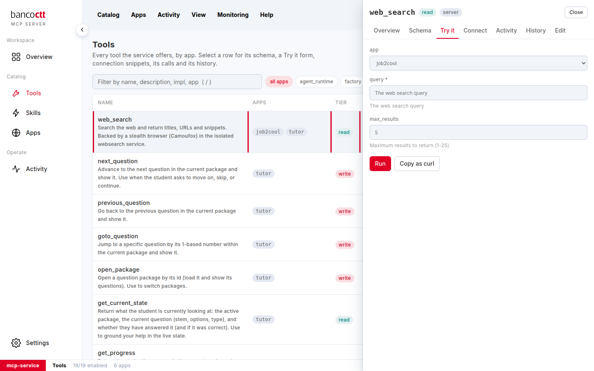

# Experimentar uma ferramenta

**Experimentar** executa uma ferramenta a partir da consola, com um formulário construído a partir do seu esquema, e
mostra exatamente o que um chamador receberia. A chamada fica registada como qualquer outra, em seu nome.

## Passos

1. Abra a ferramenta e clique em **Experimentar**.
2. Escolha a **aplicação** para a qual a chamada é feita, quando a ferramenta está oferecida a várias.
3. Preencha os argumentos: um campo de texto, um número, uma escolha verdadeiro/falso ou uma lista de valores, como o
   esquema diz. Um argumento obrigatório tem um `*`.
4. Numa ferramenta de **escrita**, marque a confirmação: diz o que a ferramenta altera e para que aplicação.
5. Clique em **Executar**. O resultado aparece em baixo com o estado, quanto tempo demorou e em nome de quem ficou
   registado.
6. **Copiar como curl** põe a mesma chamada na área de transferência, pronta para um terminal.

## Notas

- No domínio, Experimentar corre em seu nome. Na porta do serviço, cole primeiro o token de administração:
  Experimentar corre então como a consola.
- Uma ferramenta de *cliente* não pode ser executada aqui: a própria página da aplicação executa-a.
- Uma ferramenta desativada não pode ser executada; ative-a primeiro.

## Ver também
- [Ler o esquema de uma ferramenta](02-02-read-a-tools-schema.md)
- [Ver as chamadas de uma ferramenta](02-08-see-a-tools-calls.md)
