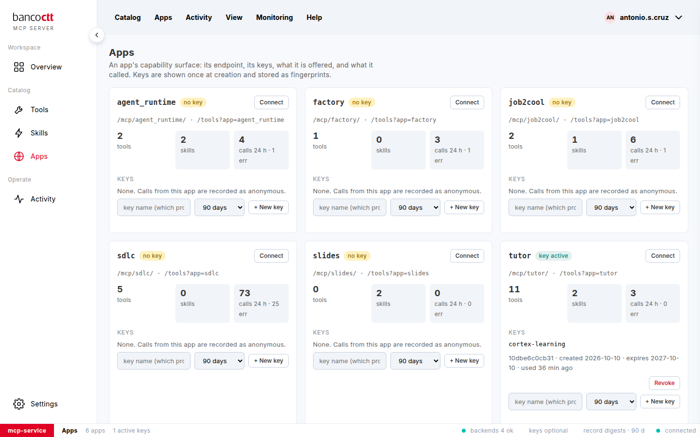

# Emitir uma chave para uma aplicação

Uma **chave** identifica o chamador. Está ligada a uma só aplicação, é mostrada **uma vez** e o serviço guarda apenas a
sua impressão digital. Uma ferramenta de escrita precisa sempre de uma chave (ou de um administrador); uma ferramenta
de leitura precisa de uma quando as chaves são obrigatórias.

## Passos

1. Abra **Aplicações** e encontre o cartão da aplicação.
2. Em **Chaves**, dê à chave o nome do programa que a vai ter (*cortex-learning*, *daily-digest*), escolha quando
   expira (90, 180 ou 365 dias) e clique em **+ Nova chave**.
3. A chave aparece uma vez, em destaque: clique em **Copiar** e guarde-a onde esse programa guarda os seus segredos.
4. Entregue-a ao programa: veja [Ligar uma aplicação](04-04-connect-an-app.md).

## Notas

- Uma chave tem o aspeto `mcpk_` seguido de 43 caracteres.
- Uma aplicação pode ter até 20 chaves ativas: uma por programa, para que cada uma possa ser revogada sozinha.
- A lista mostra o nome, o id, as datas e a última utilização de cada chave; nunca a própria chave.

## Ver também
- [Revogar ou renovar uma chave](04-03-revoke-or-rotate-a-key.md)
- [Exigir chave a todos os chamadores](07-02-require-keys.md)
