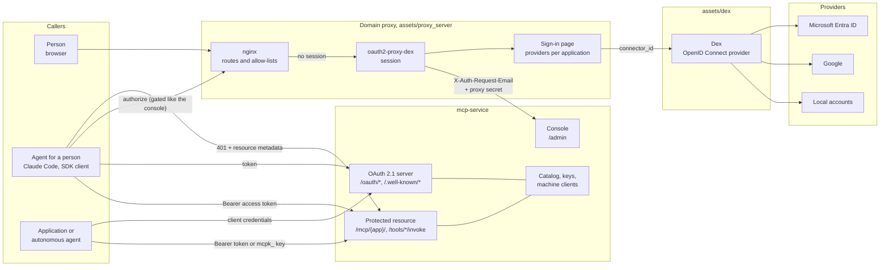
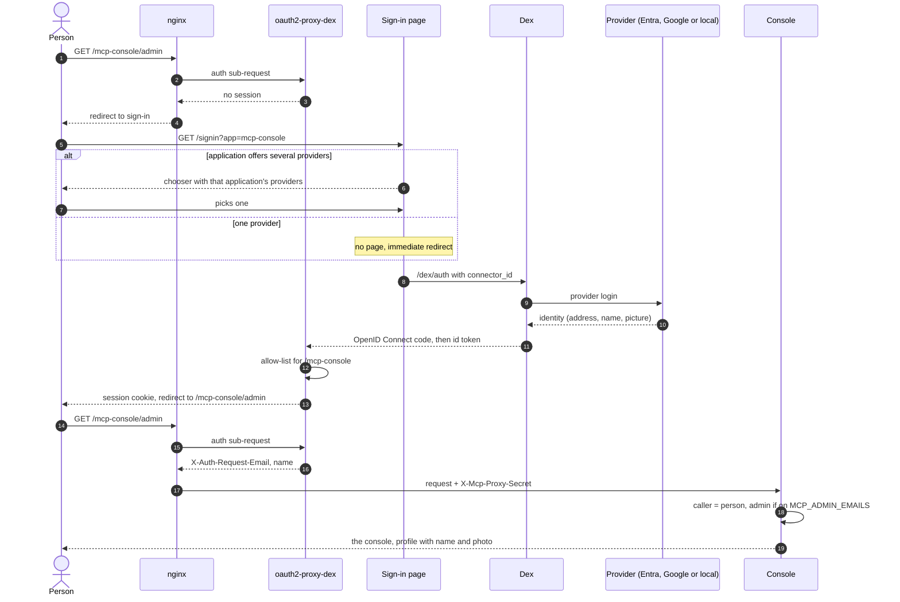
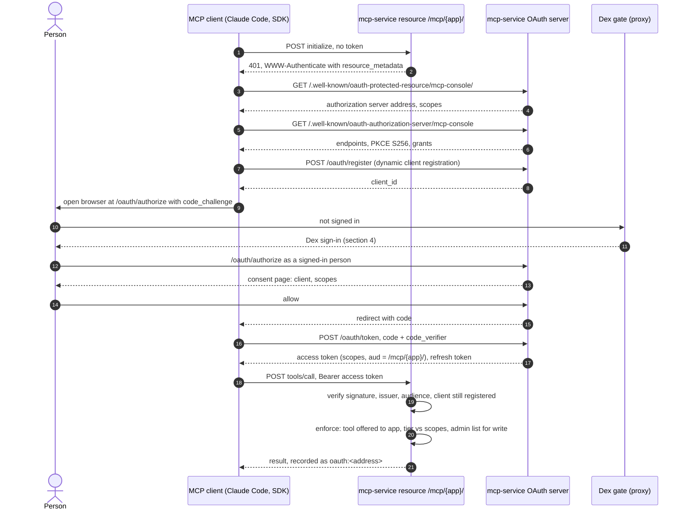
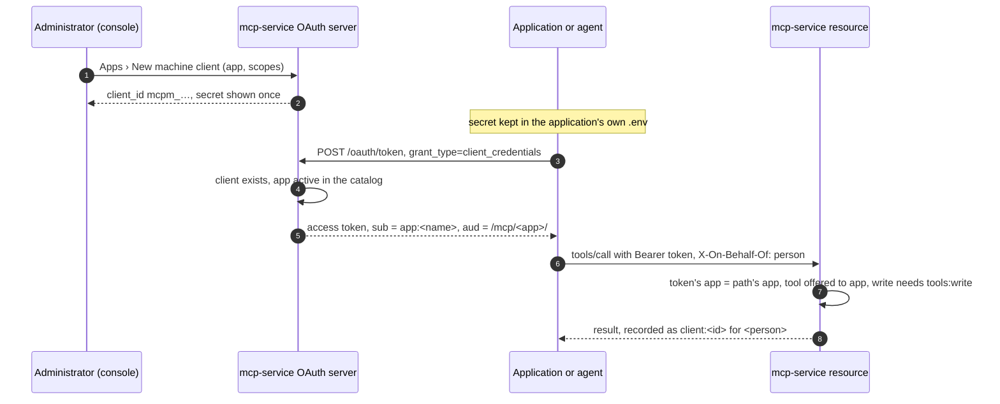
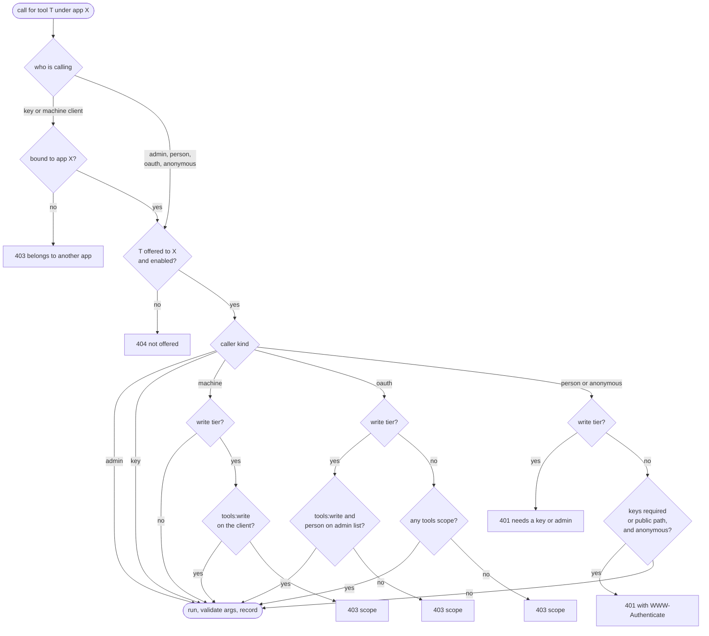
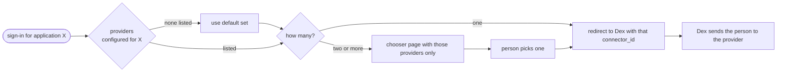

# Identity and access: people, applications and agents

How the MCP server knows **who is calling** and decides **what they may do**, for the
three kinds of caller it serves, and how the planned domain sign-in service (Dex) fits in.

Status: the MCP side (OAuth 2.1 server, app keys, machine clients, the catalog) is
implemented in `app/auth.py`, `app/oauth.py`, `app/keys.py` and `app/registry.py`. The
domain sign-in service (Dex, its proxy and the per-application sign-in page) is the agreed
design, not yet built; today the console is gated by the Entra-only proxy.

## 1. The parts

| Part | Where | Job |
|---|---|---|
| **Dex** | `assets/dex`, its own container | The domain's single identity provider. Authenticates a person against Microsoft Entra ID, Google or a local email-and-password account and issues an OpenID Connect identity to the proxy. |
| **oauth2-proxy-dex** | `assets/proxy_server` | Holds the person's session for the domain and answers nginx's "who is this?" sub-request with the person's address and name. |
| **Sign-in page** | `assets/proxy_server` | Shown only when an application offers several providers. Reads one configuration file that says which providers each application offers and sends the person to Dex with the chosen one. One provider: no page, straight through. |
| **nginx** | `assets/proxy_server` | Gates each application's routes with an allow-list, forwards the identity headers, and marks the MCP server's public locations. |
| **mcp-service** | this project | Both an **OAuth 2.1 authorization server** (issues tokens to MCP clients and to machine clients) and a **protected resource** (the tool and skill endpoints that check those tokens, keys or the proxy's identity). |
| **Application catalog** | `data/registry.json` | Every application is a record. Keys and machine clients are issued to registered, active applications only. |

Dex is the only place a password or a provider login is ever handled. mcp-service never
sees a person's credentials; it only receives, from the proxy, an address it can trust
because the request also carries the proxy secret.

## 2. Three kinds of caller

| Caller | Example | Authenticates with | mcp-service sees | May do |
|---|---|---|---|---|
| **Person** at the console | an administrator in the browser | Dex sign-in, session held by the proxy | `X-Auth-Request-Email` with the proxy secret | Reads for anyone admitted; writes and Try it only for addresses on `MCP_ADMIN_EMAILS`. Recorded by address. |
| **Agent acting for a person** | Claude Code, claude.ai connector, an SDK client on someone's laptop | OAuth 2.1 authorization code with PKCE, after the person signs in through Dex and allows the client | Access token signed by mcp-service, scopes `tools:read`, `tools:write`, `admin` | What the scopes allow, never more than the person could do. Recorded as `oauth:<address>`. |
| **Application or autonomous agent** | Cortex's learning API, the SDLC wall, a scheduled agent | A **machine client** and the client credentials grant, or an **app key** for programs that cannot run the exchange | Token with subject `app:<name>`, or `mcpk_…` key bound to one app | Only the tools offered to its application; writes need `tools:write` on the client. Recorded as `client:<id>` or by key id, plus `X-On-Behalf-Of` naming the person it acts for. |

Anonymous calls are accepted for read-tier tools only on the internal network and only
while `MCP_REQUIRE_KEYS` is not `1`. Nothing anonymous ever reaches a write-tier tool or
the public path.

## 3. How the parts connect



## 4. A person signs in to the console

The person sees, at most, two screens: the sign-in page with the application's providers
and the chosen provider's own login. If the application offers one provider, only the
provider's login appears.



What each step decides:

- **The proxy's allow-list** (step 12) decides whether this identity may enter the
  application at all, whichever provider it came from.
- **The proxy secret** (step 17) is why mcp-service trusts the address header: it is set
  in the route and nowhere else, so nothing on the internal network can name a person.
- **`MCP_ADMIN_EMAILS`** (step 18) decides whether the person may write.

## 5. An agent acting for a person connects over MCP

This is the standard MCP authorization flow (OAuth 2.1 with PKCE, RFC 8414 and RFC 9728
metadata, RFC 7591 dynamic registration). The person signs in through Dex exactly as for
the console, because the authorize endpoint sits behind the same gate, then allows the
client on mcp-service's consent page.



The token acts **for the person**: `tools:write` and `admin` are granted only to people on
`MCP_ADMIN_EMAILS`, so an agent can never do more than the person who allowed it. Refresh
tokens rotate; a revoked or deleted client makes all its tokens useless at once.

## 6. An application or an autonomous agent calls a tool

No person is in the loop. The application is registered in the catalog, and an
administrator issues it either a machine client (preferred, expiring tokens) or an app key
(for programs that cannot run the token exchange). Both are bound to **one** application.



With an app key the exchange is skipped: the key itself is the bearer, and the same checks
apply (key's app equals the path's app, tool offered to that app). Retiring an application
in the catalog refuses its keys and clients immediately.

## 7. The authorization decision

Every call, on both faces (MCP and REST invoke), goes through the same decision after the
caller is resolved. Simplified from `enforce` in `app/auth.py`:



## 8. Which providers an application offers

One file beside the proxy routes, one entry per application:

```yaml
default: { providers: [microsoft, google, local] }
apps:
  mcp-console: { name: "MCP Server", providers: [microsoft, google, local] }
  cortex:      { name: "Cortex",     providers: [microsoft] }
  job2cool:    { name: "job2cool",   providers: [google, local] }
providers:
  microsoft: { label: "Microsoft",          connector: microsoft }
  google:    { label: "Google",             connector: google }
  local:     { label: "Email and password", connector: local }
```



The chooser limits what is offered; it does not enforce. Whoever reaches Dex by another
route still meets the application's allow-list, which is where an unwanted identity is
refused.

## 9. Where things are recorded and revoked

| Thing | Issued where | Revoked where | Effect |
|---|---|---|---|
| Person's session | oauth2-proxy-dex | sign out in the profile menu (proxy sign-out) | next request needs a sign-in |
| OAuth client (agent for a person) | `/oauth/register` by the client | Settings › OAuth clients | all its tokens refused |
| Access and refresh tokens | `/oauth/token` | `/oauth/revoke`, or client deletion | token refused on next call |
| Machine client | Apps › New machine client | Apps › client's Delete | client credentials refused |
| App key | Apps › New key | Apps › key's Revoke | key refused |
| Application | Apps › New app | Apps › Retire | keys, clients and offers refused |

Every call is written to the activity record with the caller as resolved above, so the
Activity view answers "which person, through which client or application, called what".
